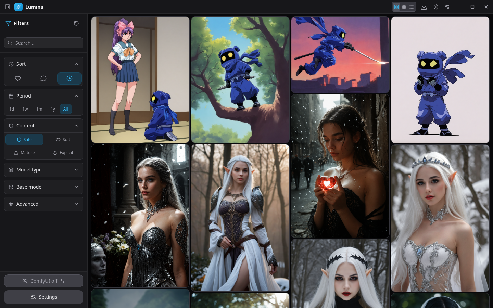
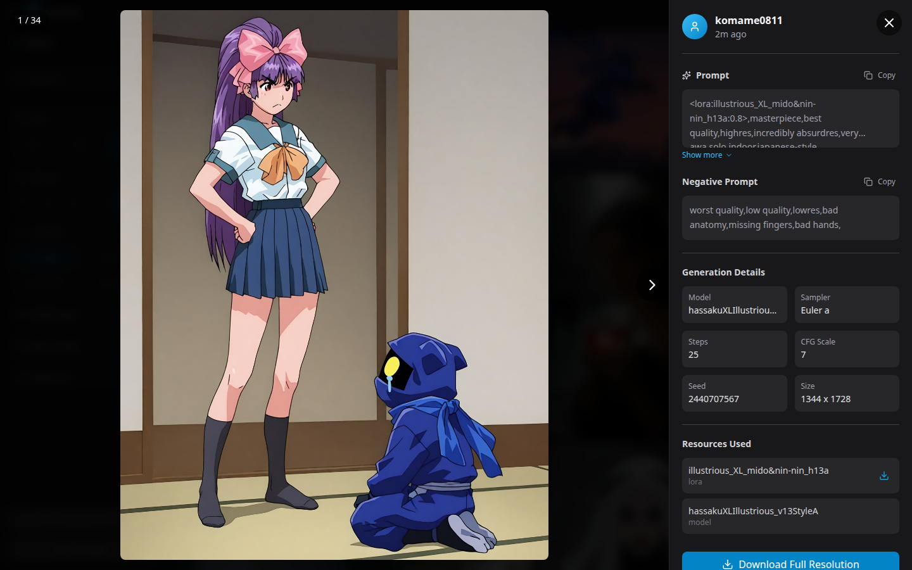

# Lumina

[](https://github.com/fabwaseem/lumina/actions/workflows/ci.yml)
[](https://github.com/fabwaseem/lumina/actions/workflows/release.yml)
[](LICENSE)
[](https://www.electronjs.org/)
[](https://github.com/fabwaseem/lumina/releases/latest)

Lumina is a cross-platform desktop gallery for browsing CivitAI images and sending their prompts into a local ComfyUI server. It is an Electron app with a frameless window, virtualized masonry, grid, and list views, a download manager, and workflow-aware LoRA handling.

## Screenshots






## Features

- Browse CivitAI images with search, base-model, period, and sort filters
- Masonry, grid, and list layouts backed by windowed virtualization
- Lightbox with prompt, negative prompt, sampler metadata, and resources
- Send a prompt to ComfyUI through an API workflow you upload and map yourself
- Check for missing LoRAs and download them into the ComfyUI `models/loras` folder
- Download manager with pause, resume, retry, and a concurrency limit
- Save images locally and open the finished file from the download panel
- Light and dark theme with desktop window controls

## Download

Installers are published by the [Release workflow](https://github.com/fabwaseem/lumina/actions/workflows/release.yml) when a `v*.*.*` tag is pushed.

[Download the latest release](https://github.com/fabwaseem/lumina/releases/latest)

| Platform | Installer |
| --- | --- |
| Windows | Squirrel setup (`.exe`) |
| macOS | Zip archive |
| Linux | `.deb` and `.rpm` |

The app checks GitHub Releases for updates on launch.

## Stack

- Electron 40 and Electron Forge 7 (Vite plugin, fuses, GitHub publisher)
- React 19 and TypeScript 5.9
- Vite 5 and Tailwind CSS 4
- Virtuoso and Virtuoso Masonry for virtualized lists
- CivitAI REST API and the local ComfyUI HTTP API

## Requirements

- Node.js 22 and npm
- A CivitAI API key is optional and raises rate limits
- ComfyUI is optional until you send a prompt

## Install

```bash
git clone https://github.com/fabwaseem/lumina.git
cd lumina
npm install
```

## Local development

```bash
npm start
```

The renderer can also be opened in a browser. Window controls and ComfyUI calls need the Electron shell.

```bash
npm run dev:renderer
```

## Scripts

```bash
npm run lint
npm run typecheck
npm test
npm run build
npm run make
```

`npm run build` packages the app. `npm run make` produces platform installers.

## Configuration

Open Settings in the app:

- ComfyUI server URL and the ComfyUI install path (`models/loras` and `output`)
- API workflow JSON and the prompt, sampler, resolution, and LoRA node mapping
- CivitAI API key
- Download folder, max LoRA size warning, and concurrent downloads

## Developer

Waseem Anjum — [fabwaseem.com](https://www.fabwaseem.com)

## License

[MIT](LICENSE) © 2026 Waseem Anjum
